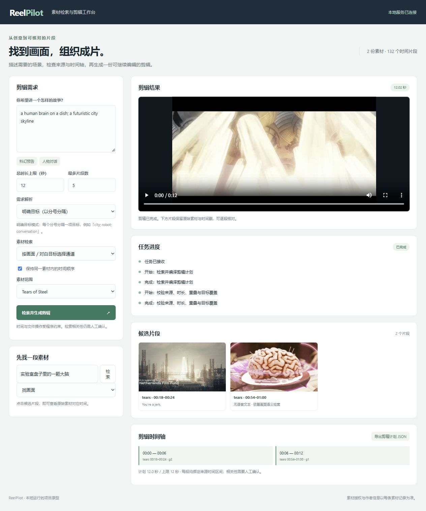

# ReelPilot

[English](README.en.md) · [参与改进](CONTRIBUTING.md) · [英文技术案例](docs/engineering/cancellation-and-completion.md)

**面向文娱素材的多模态检索与可恢复剪辑 Agent**

[](https://github.com/l422145205-source/reelpilot/actions/workflows/ci.yml)


从「找出城市、机器人、人物交流的画面」到带来源时间戳的候选剪辑：模型拆解检索目标，程序编译和校验剪辑计划，FFmpeg 执行，SQLite 记录每一步以支持失败恢复。

适用于探索内容平台、影视宣发、游戏宣传素材的检索与粗剪工作流。当前是**本地运行的工程原型**，使用公开素材验证完整链路；没有企业上线或真实业务收益数据。

## 项目重点

v0.5 新增本地 **MCP v2 工具接入**：默认只读检索与状态查询；显式开启后复用原任务队列提交/取消剪辑。真实 stdio 子进程断开后可通过原任务 ID 找回结果，同请求重放复用已验证产物。[接入与协议证据](docs/mcp.md)

v0.4 深化模型资源管理：取消感知的 FIFO 入口、有界查询缓存与同请求计算合并、可选规划器驻留、生成步控制，以及服务退出后恢复。[模型资源设计与证据](docs/model-resources.md) · [运行控制](docs/runtime-controls.md) · [代码追问入口](docs/interview-walkthrough.md)

- **时间对齐的多模态索引**：Whisper 词级时间戳、六秒窗口、中点帧；Qwen3-VL-Embedding-2B 构建画面、对白、联合内容三种索引，保留素材哈希、时间区间和授权来源。
- **有约束的 Agent 工具链**：Qwen3-0.6B + LM Format Enforcer 生成 Schema 约束目标；Beam Search 在时长上限、片段数和不重叠约束下编译 `EditPlan`，独立校验后才执行固定参数的 FFmpeg 工具。
- **可恢复执行**：SQLite 幂等请求、所有权租约、心跳与阶段日志；owner 校验和原子文件发布阻止过期 worker 覆盖结果，重试复用哈希验证后的产物。
- **可终止的任务运行**：取消意图持久化，排队等待纳入尝试 deadline；独立 worker 采用启动门、受控进程树、双路有界日志，终止确认与最终提交均有明确状态规则。线程模式保留模型复用，进程模式提供本地终止边界。
- **受控的模型资源**：关键词检索和向量缓存命中绕过模型入口；未命中查询按 FIFO 申请资源，同键请求共用一次计算。缓存限制条目与计费字节，等待者各自响应取消。可选驻留规划权重，每次重新创建解码状态。
- **有对照的方案选择**：比较 BM25、三种向量视图和 RRF，保留逐条排名和错误案例。模型加载严格检查 checkpoint keys，索引 fingerprint 不匹配时拒绝使用。
- **完整交互**：FastAPI 工作台支持画面/对白检索、原片定位、生成进度、结果播放与剪辑计划 JSON 导出。

## 看实际结果


上图来自实际检索到的城市与大脑画面；[12 秒剪辑结果](examples/recovery-preview.mp4)来自故障恢复实验。素材为 **(CC) Blender Foundation | mango.blender.org，CC BY 3.0**，此处做了截帧、缩放和片段重组。[来源与授权](THIRD_PARTY.md)。



## 五分钟运行：不需要模型或 GPU

Python 3.11+；推荐先在独立虚拟环境安装。此模式生成原创的四场景测试视频，使用明确目标和关键词检索，**不调用大模型**。

安装后可先运行 `reelpilot selfcheck`：生成原创视频，验证中断后恢复、相同请求重放与损坏产物修复，打印结果目录和 JSON。每次使用新的独立目录，保留已有文件；不下载模型。这个命令检查安装和执行链路，使用 Python 控制性异常，不替代后面的真实进程强杀实验。[实际自检报告示例](examples/selfcheck-report.json)

```bash
python -m venv .venv
# Linux/macOS: source .venv/bin/activate
# Windows PowerShell: .venv\Scripts\Activate.ps1
python -m pip install -e '.[dev]'
reelpilot demo --collection data/demo
reelpilot serve --collection data/demo
```

打开 <http://127.0.0.1:8765>，保持「明确目标」与「字幕关键词」，输入 `forest; robot`。也可直接执行：

```bash
reelpilot edit --collection data/demo --jobs data/jobs --budget 8 'forest; robot'
pytest
```

FFmpeg 可执行文件由 `imageio-ffmpeg` 依赖提供，无需写入系统目录。应用默认只绑定本机地址。

需要逐任务进程隔离时，运行 `reelpilot serve --collection data/demo --execution-backend process --request-timeout 60`。界面支持取消当前任务；`POST /api/jobs/{job_id}/cancel` 返回的是取消意图接收结果，需轮询到终态。线程中的阻塞模型调用不能立即抢占；进程模式则每次冷加载模型。[接口语义与平台差异](docs/runtime-controls.md)

## 运行真实模型与公开素材

本次验证环境：Windows、Python 3.13.9、PyTorch 2.11.0、Transformers 4.57.1、RTX 5070 Ti Laptop 12 GB。ASR 使用 CPU int8；嵌入与规划分阶段运行。检查点共约 6 GB，视频约 380 MB，处理缓存需额外空间。

先按你的硬件安装 PyTorch，然后：

```bash
python -m pip install -e '.[models,dev]'
python scripts/bootstrap_assets.py movie
python scripts/bootstrap_assets.py asr
python scripts/bootstrap_assets.py embedding
python scripts/bootstrap_assets.py planner
python scripts/prepare_open_movies.py --embed
python scripts/evaluate_pilot.py
python scripts/run_real_experiments.py
reelpilot serve --collection data/index --jobs data/jobs --embedding-model .runtime/models/qwen3-vl-embedding-2b --planner-model .runtime/models/qwen3-0.6b
```

下载脚本固定模型 revision 并校验下载大小与可用的 LFS SHA256。模型默认来自 Hugging Face；如需镜像，可通过 `REELPILOT_MODEL_ENDPOINT` 指定兼容端点。权重、完整影片、索引缓存和本地任务目录均不进入 Git。

自己的素材可用 `reelpilot ingest --help` 登记，必须提供来源与授权信息，再运行 `reelpilot embed` 构建三种索引。当前界面使用服务器已登记的素材库，不提供任意文件上传。

## 实验概况

2 份公开素材、约 13.1 分钟、132 个时间窗口；15 个场景意图对应 30 条中英文查询。标签由代理检查时间戳联系表后辅助编写，属于**开发性小样本**，不是独立人工测试集。

| 检索方法 | MRR@10 | 相关窗口集合 Recall@5 |
|---|---:|---:|
| BM25 / 字幕 | 0.1087 | 0.0620 |
| 画面向量 | **0.9319** | **0.7037** |
| 对白向量 | 0.1091 | 0.0722 |
| 画面 + 对白联合向量 | 0.7909 | 0.6005 |
| 联合向量 + BM25 / RRF | 0.6001 | 0.3907 |

这组问题以画面需求为主，无法据此判断对白路由的收益。默认采用按目标通道选视图的规则；不宣称统计显著或可泛化的提升。查询编码耗时中位数约 30.5 ms，**不含模型加载，不是完整问答或剪辑延迟**。

完成三次真实媒体运行，包括一次渲染后主动中断再恢复；该次日志记录渲染只执行一次，恢复命中缓存。v0.2 在原有 CPU 测试上补充请求容量、规划失败持久化、跨实例竞争和最终清单发布的恢复测试。测试结果见 Actions 与 [本地日志](reports/career_hardening_tests.txt)。详见[实验报告](docs/experiments.md)、[原始排名](reports/retrieval_pilot.json)、[真实运行日志](reports/real_runs.json)。

### v0.3 运行机制实验

真实强杀分别发生在渲染提交后、最终清单替换后但 SQL 提交前；两次恢复都复用已验证的渲染，render 提交次数保持 1。另验证真实 FFmpeg 运行中的取消/超时、监督进程自身死亡后的子进程退出，以及每路 5 MiB 输出只保留 64 KiB 的管道控制。取消与完成另做 20 组事务竞争测试。实验使用原创合成视频，无模型效果或生产故障率声明。

```bash
python scripts/validate_runtime.py
python scripts/measure_runtime.py --samples 5
```

[测试摘要](reports/runtime_depth_tests.txt) · [逐项故障证据](reports/runtime_fault_validation.json) · [线程/进程开销原始样本](reports/runtime_backend_benchmark.json)。CPU 开销对照不加载模型，不能替代 GPU 推理或生产吞吐测试；具体注入方法、测试替身和限制见[实验说明](docs/runtime-fault-lab.md)。

### v0.4 模型资源与退出实验

本地完整验证为 103 项通过，含旧故障回归及真实 FFmpeg 退出后用原请求重启恢复。随机初始化的 6384 参数 CPU Transformer 另验证实际生成循环：第 4 个 forward 触发取消，部分输出不接受；同键并发向量探针将 8 次基线 forward 合并为 1 次。它只证明调用与控制机制接通，不代表 Qwen 模型质量或 GPU 加速。

受控回调对照与 500 查询容量抖动另存原始数据，清楚标注注入延迟；默认缓存上限 256 条、16 MiB 计费字节，并非显存或 RSS 上限。规划器驻留默认关闭，开启需要额外内存。详细方法、失败定位与边界见[资源实验说明](docs/model-resources.md)。

```bash
python scripts/validate_resources.py
python scripts/measure_model_resources.py
# 已安装 models 依赖时，下面的探针不下载权重
python scripts/validate_generation_control.py
```

[最新测试摘要](reports/resource_depth_tests.txt) · [资源验证与进程恢复](reports/resource_validation.json) · [真实微型模型探针](reports/generation_control.json) · [受控对照](reports/model_resource_experiment.json)

## 实现边界

固定窗口与单帧可能漏掉短动作或截断台词；当前不做镜头边界检测。小模型仍会扩写需求，真实预告片实验中城市目标召回了室内全息场景。结构验证保证来源和执行约束，**不证明画面语义、审美或叙事质量**。最终选片需要审片。

可恢复执行不是 exactly-once；进程崩溃可能重跑工具。当前是单实例本地服务，没有多租户、鉴权或公网部署加固。Ollama 后端已实现，但本次未进行服务实测。Docker 示例未在本机完成构建验证。

进程隔离用于可信工具的生命周期控制，不是安全沙箱。Windows Job Object 与 POSIX 进程组/父进程轮询的保证不同；取消本地 worker 也不保证远端服务停止计算。文件改名与 SQLite 提交之间的恢复测试不等于断电一致性验证。

## 进一步阅读

- [MCP 接入、幂等调用与跨会话恢复](docs/mcp.md)
- [技术架构与模块](docs/architecture.md)
- [实验设计、消融与失败分析](docs/experiments.md)
- [产品目标与验收范围](docs/product-brief.md)
- [面试讲解](docs/interview.md) · [简历条目草稿](docs/resume_excerpt.md)
- [第三方来源](THIRD_PARTY.md) · [代码许可](LICENSE)

代码由 AI 编程工具辅助实现；实验由本地真实运行产生，保留原始记录和明确边界。基础模型来自公开检查点，本项目没有训练或微调这些模型。
