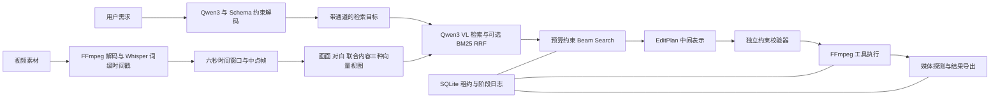

# 技术设计

ReelPilot 将视频剪辑拆成需求解析、证据检索、剪辑计划编译、独立校验、媒体执行和输出检查六个环节。语言模型生成检索目标；程序从已登记的素材时间区间编译剪辑计划，控制实际执行。

## 时间轴与表征

源视频按固定六秒窗口组织，以词级时间戳的中点将转写词分配到窗口。每个窗口解码一个中点帧。素材 SHA256、时间区间、转写来源和授权信息随索引保存。低均值、低标准差的近纯黑帧被标记，画面检索与计划校验会排除这些窗口。该规则不能识别所有转场、片尾或不可用镜头。

Qwen3 VL Embedding 2B 分别编码画面、对白和画面加对白。查询使用同一检查点、指令和 pooling。模型与索引保存一致的 fingerprint；库哈希、向量行序或编码器 fingerprint 不匹配时拒绝检索。加载模型时检查 missing、unexpected 和 mismatched keys，防止错误加载后使用随机初始化权重。

默认 adaptive 策略将 visual 目标送入画面向量检索，dialogue 目标送入对白向量与 BM25 融合，mixed 目标使用联合向量。它是一条可解释的任务规则。开发性评测只比较了画面问题，不足以证明对白路由的收益。

## 结构化模型输出

本地 Qwen3 通过 LM Format Enforcer 约束 JSON Schema，返回 query 和 channel。Pydantic 再校验对象、数量与字段。模型输出不能覆盖用户设置的时长和片段数，不能直接指定文件、时间戳或命令。Ollama 接口采用其结构化输出功能；未运行该服务时不声称验证过该后端。

明确目标模式允许以分号分隔需求，并可用 `visual:`、`dialogue:`、`mixed:` 指定通道。它是确定性输入方式，界面与结果均保留 explicit 标记。

## 剪辑计划编译与验证

编译器从每项目标的候选片段中进行有界 Beam Search，综合排序名次，满足时长上限、片段数、来源区间与不重叠约束。相同片段可以承载多个目标。搜索宽度是工程参数，不提供全局最优保证。

独立验证器核查库版本、片段归属、时间边界、目标引用、覆盖、近纯黑帧、不重叠及时间顺序。目标被引用意味着选片过程为其分配了证据，并不等价于已验证画面语义正确。最终效果仍需要审片。

当前时长是上限；系统可以返回短于上限的结果。固定六秒窗口也不保证动作、台词或镜头边界完整。

## 可恢复执行

SQLite 保存原始请求的幂等键、解析后的请求、阶段结果和事件。相同键与不同请求冲突时返回 409。恢复执行复用保存的 QuerySpec，避免再次调用模型改变已解析需求。

worker 通过条件更新取得带过期时间的所有权。阶段提交和文件发布在 SQLite 写事务中校验 owner 与租约；过期 worker 不能发布文件。执行先写 owner 专属尝试目录，再原子替换正式输出。

完成阶段的缓存会检查内容哈希。输出文件被破坏时重新执行渲染。进程崩溃可能导致子进程重复执行；该实现保证有条件的安全重放，不宣称 exactly once。早期实验主动抛出异常；v0.3 另加入真实 OS 强杀与子进程清理测试，仍不包含断电或机器故障。[故障矩阵与复现](runtime-fault-lab.md)

FFmpeg 只接收程序构造的参数列表，始终 `shell=False`。用户或模型文本不会成为命令。渲染后检查可解码性、时长误差、分辨率及音视频流。

v0.3 将 pipeline owner 关联至 request owner，提交时同时检查取消标记、截止时间和两层所有权。`Journal.finalize` 在同一 SQLite 写事务中处理最终清单替换与两张表的完成状态，与取消操作串行裁决。文件替换后 SQL 提交前死亡时，物理文件不会作为已完成结果提供。

可选独立进程后端在任务启动门之后才导入模型和执行工具，监督器通过受控进程组/Windows Job Object 终止本地工作树，并以双路有界缓冲排空日志。线程后端继续复用模型，阻塞模型调用仅能协作取消。两者取舍与平台边界见 [控制设计](runtime-controls.md)。

## 模块对应

| 模块 | 代码 |
|---|---|
| 数据与契约 | `schema.py`、`library.py` |
| 媒体转写与索引 | `ingest.py`、`encoders.py` |
| 检索和计划 | `retrieval.py`、`planner.py`、`compiler.py` |
| 执行与恢复 | `admission.py`、`journal.py`、`pipeline.py`、`control.py` |
| 进程监督与工具 | `execution.py`、`supervisor.py`、`worker.py`、`processes.py`、`media.py` |
| 接口和交互 | `api.py`、`static/`、`cli.py` |
